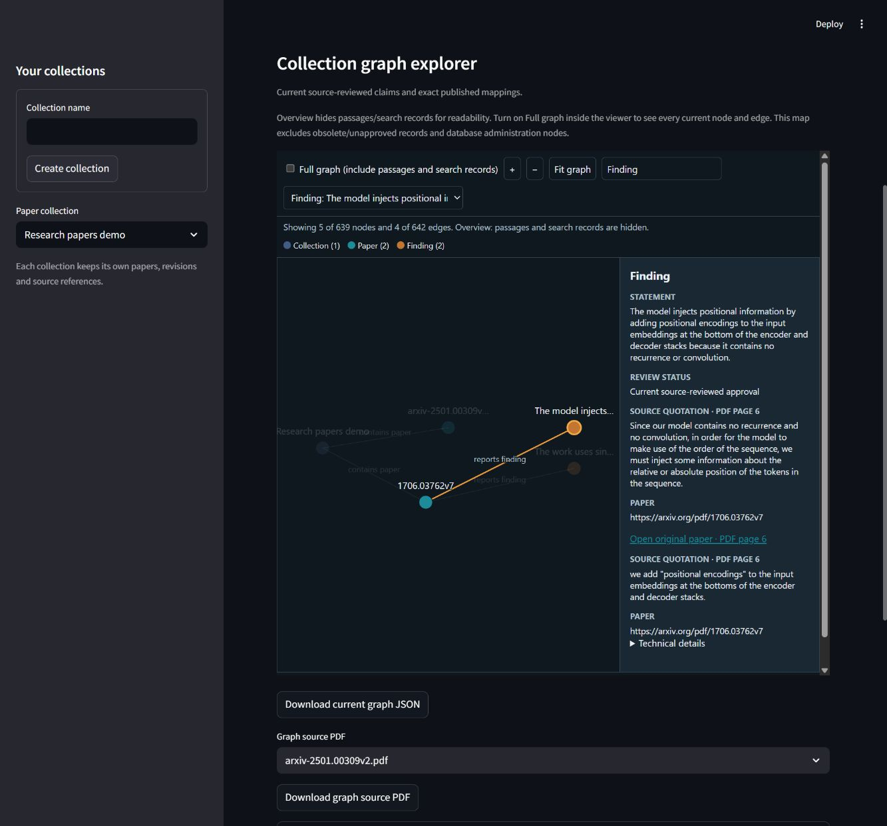

# M9 - Read-only graph explorer outcomes

**M9.1-M9.3 complete, 22 November 2026.** The current local product at http://127.0.0.1:8504/ has an optional interactive collection graph. Work remains in the m8-user-collections checkout. This extends the product UI, without altering retrieval algorithms, model/provider settings, claims, approvals, data or either research study. The implementation task prepared local changes; the user subsequently explicitly authorized GitHub publication. Verify actual main for release status. All v1-v5 submission packages remain unchanged historical deliveries.

## Changes and boundaries

- `collections/graph_view.py` owns typed complete node/edge snapshots. It calls existing collection/source verification, journal eligibility projection, locks, published-index checks and strict reviewed relationship-role validation. It does not infer entities, merge names, approve claims or run embeddings/generation. Scientific nodes require current source-valid published human approvals. Source-only maps show document ownership, not inferred scientific links.
- `ui/collection_graph.py` renders verified snapshots and source/PDF/JSON controls. `collection_graph.html` is a local interactive SVG view with no CDN/network library or new dependency. It supports fit/zoom/pan/drag, search, node/edge selection, keyboard interaction, clear types, quotations and original PDF-page links. Untrusted content stays in escaped JSON/textContent. Technical metadata is collapsed.
- The overview hides passages/search records with explicit counts. Full view exposes every current logical source/review node and edge, without a hidden cap. It excludes administrative nodes, old revisions, rejected/pending proposals and other collections. It is not a raw Neo4j browser or a visualization of one answer's actual retrieval path. MENTIONS is never promoted to an authoritative scientific relation.
- Specification6.12 and the submission summary record this scope. Exact6.11 files are archived. M8 milestones and both consumed study scopes remain closed.

## Verification

| Check | Actual outcome |
|---|---|
| Full offline suite after service/UI integration | **510 passed, 11 integration cases deselected**, five existing PyMuPDF/SWIG warnings. |
| Final focused graph tests after UI polish and capacity coverage | **16 passed**, with five existing warnings. Covers scope/head/source changes, stale publication, revocation, role/support/alias/index failures, absence of auto-approval/name merging, 3,000-passage completeness, HTML injection and UI no-inference behavior. |
| Browser | Actual restarted server loads. AI and physics overview/full counts match their snapshots. Mouse node selection, keyboard relationship selection, search, source quotations/page links, zoom, node drag, background pan and fit verified. Full view renders639/642 AI nodes/edges and150/149 physics nodes/edges. |
| Native read-only service | Five existing indexed collections load, including two current demo topics and earlier explicitly labelled engineering/synthetic collections. The latter are historical fixtures, not genuine human approvals or quality evidence. |
| Export | Actual downloaded graph JSON matches every field of the native validated AI snapshot. Source PDFs use the same checked bytes as the existing collection service. No fresh graph-source PDF download is claimed. |
| Packaging | Viewer JavaScript syntax passes. Built wheel includes the HTML viewer and both new Python modules. Initial offline wheel build lacked cached hatchling1.33.0; normal isolated build using the existing pinned build requirement then passed. Runtime dependencies/lock were unchanged. |
| Dependencies | Locked offline consistency and installed-package compatibility checks pass. No application dependency/model upgrade. |
| Preservation | M8 canonical graph stays846 nodes/861 relationships with the same digest. All241 source/review/accounting files remain unchanged. All93 prior public submission/coursework files remain unchanged. Old baseline/M5 frozen assets are checked separately in the local acceptance record. |

The first focused run had14 passes and one test-fixture error using a nonexistent PDF-path field. The test was corrected to the existing owned source-path resolver; the source guard itself did not change. Browser inspection identified a narrow-panel label/centering problem, corrected before handoff. Some automation selectors for styled checkboxes/SVG paths were unsupported; the actual controls were exercised through their visible labels, native circle selection and keyboard edge selection. These were UI automation issues, not model retries or human review decisions.

## Current examples and interpretation

`Research papers demo`:5 overview nodes/4 edges. The full map has639 nodes/642 edges, including632 passages and two approved Finding/search-record pairs. There are no named method/dataset mappings on those claims. `Gravitational-wave research`:2 overview nodes/1 edge, or150 nodes/149 edges with all148 passages, and zero approved scientific claims. No connections were invented to make either map look richer.

The graph helps explain stored sources and reviewed relationships. Its existence does not establish improved answer quality. Original negative Graph findings and exploratory author-context disclosures remain intact. The ordinary QA pipeline is unchanged and was covered by the offline suite; no new live question encoding, answer generation, extraction, import, index publication or human decision occurred. The existing11 opt-in integration cases were not rerun, and no full-capacity live-browser/endurance/mobile acceptance or new research evaluation is claimed. A3,000-passage complete map is verified in a synthetic contract test; browser interaction was checked on up to639 real logical nodes.

The prospective local engineering scope allowed24 graph snapshot loads and8 supplemental read-only captures, with zero model/provider/encoder/import/extraction/new-review/paid operations. Actual requests/capture counts and source/graph/preservation hashes are recorded in runs/m9/graph-explorer/acceptance.json. This scope closes at handoff; ordinary explicit graph browsing remains available. No research, paid or private-evaluation authorization follows. Local screenshots and native snapshots stay local; only the public demonstration image/user guide are intended for publication.

