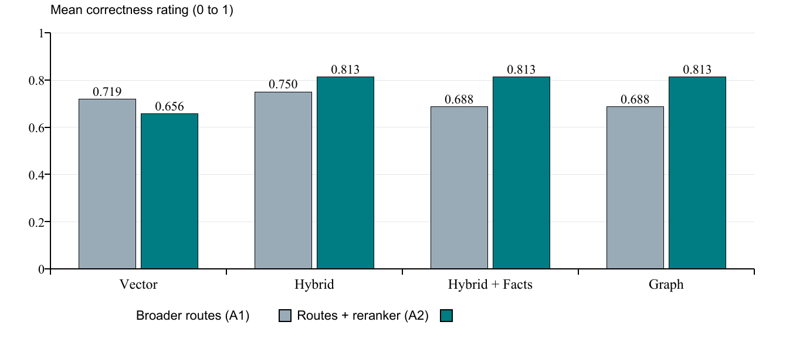
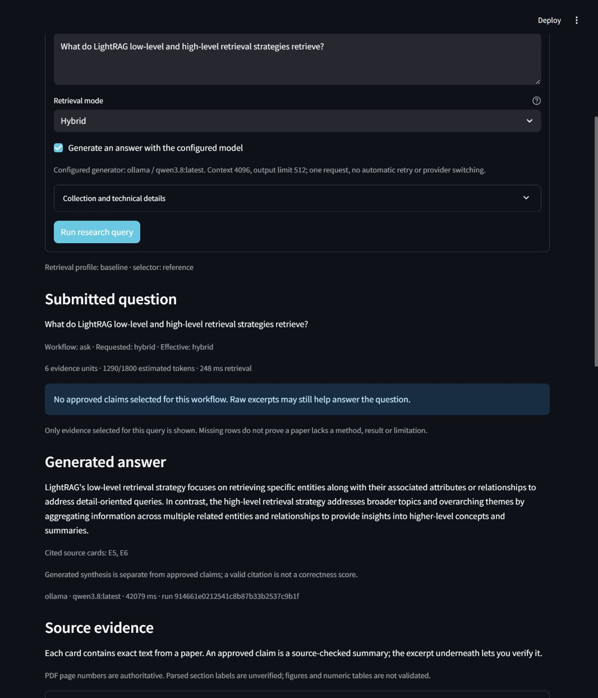

# Scientific Research Knowledge Assistant

Graph retrieval, source-grounded question answering and controlled evaluation

Sergei Iakovlev | DBU Deep Learning | 19 November 2026

### Abstract

This project builds a local assistant for studying artificial-intelligence research papers. It combines semantic and lexical search, a human-reviewed scientific knowledge graph, and a pretrained local language model. Users can ask questions, inspect exact source excerpts, see approved claims and any selected graph connections, and export the evidence. The implementation compares Vector, Hybrid, Hybrid + Approved Facts, and Graph retrieval under a common evidence budget. The graph condition is tested against the fact-augmented ablation so that any gain from graph traversal can be separated from access to reviewed claims.

A five-paper pilot preceded a twenty-paper corpus containing 1,427 indexed chunks and 51 active human-approved claims. Two frozen studies used eight development and sixteen held-out questions each. The original study produced 96 answers; a later exploratory study compared twelve matched conditions across 288 answer slots. Human scores were sealed before condition reveal. In the original held-out sample, Hybrid obtained the highest mean correctness rating, 0.7188. In the exploratory sample, reranked Hybrid, Hybrid + Facts and Graph tied at 0.8125. Every held-out Graph request fell back to its matching fact-augmented context in both studies. The results therefore demonstrate no held-out benefit from selected graph traversal. Reranking showed mode-dependent quality and latency trade-offs.

### Problem and research question

A research question can require definitions, methods, evaluation conditions and limitations from several publications. Similarity search can retrieve related text without connecting the required reports, while fluent generation can blur attribution or invent comparable scores. The central question is: does bounded retrieval over reviewed graph relationships improve source coverage and answer quality over matched non-traversal baselines?

### Deliverable and contribution

The product is a Python/Neo4j pipeline with a Streamlit interface for students and researchers. The contribution is an implemented, auditable comparison and a working evidence-inspection workflow. Success does not depend on a positive Graph result. This is an inference and systems-evaluation project using pretrained neural models; no neural network was trained or fine-tuned. [E1-E4]

<!-- Report page boundary -->

## 1. Deep learning components and background

Retrieval-augmented generation conditions a language model on retrieved material. The original RAG work combines parametric generation with an external retrieval memory [1]. This project follows that broad pattern, but does not reproduce its training procedure. GraphRAG research motivates relationships as an additional retrieval structure [3-7]; the implemented system uses bounded source-backed paths rather than claiming to reproduce any one paper in full.

### Dense retrieval and reranking

A bi-encoder maps a question and each indexed passage independently to vectors. Transformer token representations are pooled into fixed-size sentence embeddings; the selected Sentence Transformers models use attention-mask-aware mean pooling and normalized vectors. Cosine similarity ranks semantic proximity. MiniLM produces 384-dimensional embeddings and is shared across the four main modes. MPNet produces 768-dimensional embeddings and is evaluated separately for vector-only retrieval. Sentence-BERT explains the efficiency of precomputing comparable sentence representations [2,8,9].

The exploratory reranker instead processes each question/evidence pair jointly with a pretrained cross-encoder. It can model token-level interactions that independent embeddings lose, but requires an inference for every candidate. The implementation uses raw relevance logits, deterministic ties and the same feature/packing rules across all modes. It validates a 512-token native pair limit and scores at most 88 unique candidates. Overlength, missing-model or inference failures are explicit errors, not silent truncation or provider substitution. [10,E1]

| Component | Identity and role |
| --- | --- |
| Encoder | all-MiniLM-L6-v2; revision 1110a243...; 384 dimensions, CPU |
| Encoder comparison | all-mpnet-base-v2; revision e8c3b32e...; 768 dimensions, CPU |
| Shared reranker | ms-marco-MiniLM-L6-v2; revision 233902d2...; CPU float32 |
| Local generator | Installed alias qwen3.8:latest; recorded qwen35-family GGUF, 27.3B, Q4_K_M |
| Generation bounds | 4,096 context / 512 output tokens; concurrency one; no automatic retries |

### Neural inference, not model training

The weights are externally pretrained. The work evaluates embedding selection, candidate routing, neural reranking and evidence-grounded generation, rather than optimization of a training loss. No training dataset, learning curve or fine-tuning improvement is claimed. The installed Ollama alias is a local label, not evidence of an official model release called Qwen 3.8; the recorded model digest identifies the actual experimental asset. [E1,E3]

The workstation uses Windows, approximately 32 GB RAM and an RTX 4070 Ti with 12 GB VRAM. The pinned stack includes Python 3.11.13, PyTorch 2.6.0, Sentence Transformers 4.1.0, Transformers 4.57.6, Neo4j 5.26.x and Streamlit 1.45.1. Model revisions, exact digests and dependency pins are retained in manifests and uv.lock. Tight memory headroom limits broader deployment claims.

<!-- Report page boundary -->

## 2. Corpus, architecture and data integrity

The initial five papers cover a GraphRAG survey, Edge et al.'s Graph RAG, original HippoRAG, LightRAG and HippoRAG 2 [3-7]. The corpus expands to twenty selected papers using recorded selection and ingestion manifests. arXiv supplies paper versions; OpenAlex supplies publication/citation metadata. Only indexed pages are in scope. Excluded appendices, extraction limitations and unverified numerical tables remain limitations rather than silently available knowledge. [E1,E4]

| Layer | Boundary and state |
| --- | --- |
| Preparation | PDF parsing, page/offset provenance, fixed retrieval chunks and longer extraction passages |
| Review | Candidate/revision/source/entity bindings, immutable human decisions, current review journal |
| Graph repository | Parameterized Cypher, typed records, index readiness, paper ownership and approval checks |
| Retrieval services | Candidate pools, approved routes, selection, shared evidence packing and explicit fallback |
| Generation / pipeline | One provider contract, context/citation validation, immutable run records and failures |
| CLI / Streamlit | Call the same services; display answers, sources, selected paths and evidence exports |

### Reviewed scientific graph

The expanded corpus has 1,427 indexed chunks and 51 active approved claims: 23 pilot claims plus 28 expansion claims. Claims include qualitative Findings and paper-owned Evaluations, linked to reviewed Method/Dataset identities when supported. Unknown versions, splits, metric definitions or protocols remain unknown. Shared benchmark names identify base entities, not controlled score comparability. Citation edges can guide discovery, but do not independently support an answer.

Each approved claim preserves its exact source quotation, location, revision and entity mapping. Human approval certifies support by that source; it does not independently replicate the scientific experiment or establish universal truth. New claim revisions require fresh decisions. Fact-mode reads validate the current journal head against the graph projection, preventing a stale approved view after a review change.

### Shared contracts

EvidenceItem is the common boundary between retrieval, generation, UI and export: stable evidence ID, paper/chunk or claim revision, exact support spans, page/section metadata, known conditions and selected graph path where applicable. Query records retain requested mode, effective mode, fallback reason, settings, timings and provenance. Raw source excerpts and approved claims are distinct evidence types; a raw chunk has not automatically received human approval.

Credentials, downloaded PDFs, model caches, database volumes and private evaluation material remain outside Git and the submission archive. Service/index/stale-data failures stop the operation. Explicit fallback is reserved for a successful Graph attempt with no newly selected eligible graph evidence. The application does not generate Cypher, merge ambiguous methods automatically, or replace its provider silently. [E1]

<!-- Report page boundary -->

## 3. Retrieval conditions and controlled iteration

| Requested mode | Candidate source | Purpose |
| --- | --- | --- |
| Vector | Semantic chunk search | Dense retrieval baseline |
| Hybrid | Vector + lexical chunk search; RRF | Test lexical/semantic combination |
| Hybrid + Facts | Hybrid + searchable human-approved FactText | Control for access to reviewed claims |
| Graph | Same fact-augmented pool + bounded approved paths | Test incremental traversal evidence |

Hybrid retrieves the top twelve candidates from each channel and applies reciprocal-rank fusion with k = 60. FactText contains an approved assertion, revision, attribution, conditions and supporting quotations and is indexed for both semantic and lexical search. The Graph contrast is meaningful only relative to Hybrid + Facts with matching source data, ranking policy and evidence budget. Comparing Graph only with Vector would confound traversal with lexical search and access to reviewed claims.

### Common selection and evidence budget

All modes assemble at most six evidence units and 1,800 estimated tokens, including metadata, claims, excerpts and serialized selected paths. One approved fact with up to three supporting excerpts is one atomic unit. The pinned estimator is shared; these are estimated tokens, not a promise about the generator's native tokenizer. Source deduplication and greedy packing apply across modes. Retrieval metrics use the context actually passed to generation, not an unselected candidate pool. [E1]

Graph retrieval uses fixed parameterized route families for shared methods, shared datasets, citation links and finding/evaluation relationships. Approved-current claims and source ownership are mandatory. Candidate counts, path lengths, seed selection and database timeouts are bounded. If no new eligible graph evidence survives ranking and packing, Graph returns the exact matching Hybrid + Facts assembly and exposes the effective mode and reason. A graph existing in the database is not evidence that traversal contributed to an answer.

### Exploratory architecture iteration

The follow-up preserves the original twenty-paper/51-claim catalog. A0 is the reference implementation. A1 broadens source-backed routes and anchors with the reference selector. A2 applies those routes plus one shared cross-encoder selector across all four modes. Up to four anchors, sixteen template calls, eighty intermediate rows, forty graph candidates and five-edge paths bound the new routing contract. No generated community summaries, Personalized PageRank implementation, fine-tuning or corpus replacement was added.

This three-arm design separates route-policy and selector-policy comparisons while retaining matched Graph/fact-ablation pairs. Reranking can affect both anchors and final selection, so its end-to-end contrast does not isolate one causal mechanism. The earlier development retrieval gate was negative: no mean Graph source-recall gain was found. The user later explicitly authorized the frozen exploratory study despite that result and the disclosed question-author exposure. It is not relabeled a passed development gate. [E3]

<!-- Report page boundary -->

## 4. Evaluation design and measurement

| Design element | Original study | Exploratory follow-up |
| --- | --- | --- |
| Corpus / claim catalog | 20 papers / 51 claims | Same catalog |
| Question split | 8 development + 16 held-out | 8 development + 16 fresh held-out |
| Conditions / answer slots | 4 modes / 96 answers | 3 arms x 4 modes / 288 slots |
| Extra encoder comparison | 48 retrieval-only reads | None |
| Human answer scoring | 96 rows; ~60 active minutes | 288 rows; ~60 active minutes |
| Execution | One frozen local run; $0 paid | One frozen local run; $0 paid |

Each twenty-four-question set has six direct, six cross-paper, six multi-hop and six scoped-unanswerable items: two of each category in development and four in held-out. Human gold validation is separate from graph-claim approval. Gold facts are independent source-span annotations with alternative sufficient sets and explicit AND/OR support rules. They are excluded from retrieval inputs. Oracle source witnesses check annotation feasibility, not retriever success. Absence-keyword scans support human triage but cannot prove unanswerability alone.

### Metrics

Correctness uses human ratings 0 (wrong), 0.5 (partial), and 1 (correct and fully supported). Citation support is scored separately using the defined rubric. Reported means include all sixteen held-out questions and are mean ratings, not accuracy percentages or answerable-only scores. Paired wins/ties/losses compare the same question under matched conditions.

Evidence Recall@6 is the maximum fraction of gold facts covered across alternative sufficient sets, using exact source support in the assembled six-unit context. Required AND spans must all be covered; any accepted OR alternative can satisfy its rule. It averages over the twelve answerable held-out questions. The four unanswerable items have recall N/A. A correct abstention must distinguish absent corpus evidence from a retrieval miss; a made-up measurement is penalized.

### Freezing, blinding and scope

The approved freezes bind code, corpus, current reviews, annotations, prompts, settings and model identities. Dedicated once-only runners keep held-out inputs and individual outputs in external evaluator directories. Human rows are validated and sealed before guarded condition reveal; the development report reads public aggregates only. This is procedural context separation, not OS-enforced isolation. No test is restarted or reclassified as untouched after use. [E2,E3]

Retrieval medians include integrity checks and selection, and exclude generation; cache/order and workstation state are not controlled cold-start benchmarks. The follow-up question author received prior outcome summaries. The user accepted that disclosed selection-bias limitation, so the follow-up is exploratory. Different held-out questions prohibit interpreting differences between the two studies' raw means as an architecture improvement. Neither study has a second independent human rater or population-level inference.

<!-- Report page boundary -->

## 5. Original frozen study: held-out results

The original run completed 96 answer generations/provider responses and 48 additional vector-only encoder reads, with zero failures or automatic retries and $0 paid API spend. The table below summarizes its sixteen held-out questions. Citation is mean human citation-support rating; recall averages over twelve answerable questions. Rounding is for presentation only. [E2]

| Requested mode | Correctness | Citation | Recall@6 | Retrieval ms |
| --- | --- | --- | --- | --- |
| Vector | 0.5312 | 0.2500 | 0.1528 | 154.5 |
| Hybrid | 0.7188 | 0.4375 | 0.3889 | 100.6 |
| Hybrid + Facts | 0.5625 | 0.2500 | 0.1944 | 243.3 |
| Graph | 0.5625 | 0.2500 | 0.1944 | 351.0 |

*Table 1. Original held-out results (n = 16; recall n = 12). Retrieval values are medians in milliseconds, excluding generation.*

### Interpretation

Hybrid has the highest mean correctness in this sample, 0.71875, compared with Vector's 0.53125. The paired comparison is six Hybrid wins, nine ties and one loss. Hybrid also has the largest source recall, 0.3889. These descriptive results support lexical/semantic combination for this setting, without establishing a general superiority theorem or selecting an application default after inspecting held-out scores.

Hybrid + Facts and Graph both obtain correctness 0.5625, citation support 0.25 and evidence recall 0.1944. Graph falls back on all sixteen held-out questions and all twenty-four questions overall. Saved Graph/fact-ablation contexts are identical. Across all twenty-four Graph requests, twenty failures to add evidence occur after graph evidence is not selected and four have no eligible graph candidate. This is absence of incremental selected evidence under the tested contract, not proof that every possible graph architecture is ineffective.

### Separate embedding comparison

| Vector-only encoder | Held-out Recall@6 | Median retrieval ms |
| --- | --- | --- |
| MiniLM | 0.1528 | 151.0 |
| MPNet | 0.2083 | 385.6 |

MPNet has slightly higher held-out evidence recall and higher observed retrieval latency. On development questions, MiniLM recall is 0.2778 and MPNet is 0.1667; pooled recall is equal at 0.1944. Both use the fixed 0.30 vector threshold, which may have different calibration across encoders. No held-out tuning or unconditional encoder upgrade follows. These retrieval-only reads do not supply a second set of generated answers.

The original study's development scores and pooled aggregates remain in the public evidence files. They are not substituted for held-out headlines. Human answer scoring took approximately sixty active minutes; separate claim/gold preparation had substantial recorded human effort. Local electricity, embodied hardware cost and carbon emissions were not measured, so $0 paid API spend must not be described as zero total project cost.

<!-- Report page boundary -->

## 6. Exploratory follow-up: matched policies

The authorized follow-up completed 288 answer slots across twenty-four questions and twelve conditions. The public report does not expose an exact provider-response total. All 288 submitted human score rows were sealed before reveal, without edits. Held-out means below use sixteen questions; recall uses twelve answerable questions. A0 = reference; A1 = broader routes; A2 = broader routes plus shared reranking. [E3]

| Arm / mode | Correctness | Citation | Recall@6 | Retrieval ms |
| --- | --- | --- | --- | --- |
| A0 / Vector | 0.7188 | 0.5625 | 0.3889 | 68.8 |
| A0 / Hybrid | 0.7500 | 0.5312 | 0.4722 | 42.8 |
| A0 / Hybrid + Facts | 0.6875 | 0.5312 | 0.3889 | 113.0 |
| A0 / Graph | 0.6875 | 0.5312 | 0.3889 | 154.2 |
| A1 / Vector | 0.7188 | 0.5625 | 0.3889 | 69.1 |
| A1 / Hybrid | 0.7500 | 0.5312 | 0.4722 | 43.0 |
| A1 / Hybrid + Facts | 0.6875 | 0.5312 | 0.3889 | 115.9 |
| A1 / Graph | 0.6875 | 0.5312 | 0.3889 | 159.0 |
| A2 / Vector | 0.6562 | 0.5000 | 0.3611 | 343.3 |
| A2 / Hybrid | 0.8125 | 0.6250 | 0.4861 | 506.5 |
| A2 / Hybrid + Facts | 0.8125 | 0.6250 | 0.4861 | 921.8 |
| A2 / Graph | 0.8125 | 0.6250 | 0.4861 | 998.0 |

*Table 2. Exploratory held-out results. Retrieval medians exclude generation. Every Graph arm falls back on 16/16 held-out questions.*

### Primary and matched comparisons

The primary contrast, A2 Graph versus A2 Hybrid + Facts, is zero correctness wins, sixteen ties and zero losses. Both have correctness 0.8125, citation support 0.6250 and recall 0.4861. A1 Graph also ties its fact ablation on every held-out question. A1 and A0 have identical held-out quality metrics in all four modes: broader routing yields no observed held-out quality gain.

| A2 versus matching A1 mode | Wins | Ties | Losses |
| --- | --- | --- | --- |
| Vector | 0 | 14 | 2 |
| Hybrid | 3 | 12 | 1 |
| Hybrid + Facts | 4 | 12 | 0 |
| Graph | 4 | 12 | 0 |

The reranked policy raises mean correctness by 0.0625 for Hybrid and 0.1250 for fact modes on this sample, while Vector drops by 0.0625. These are differences in mean rubric ratings, not percentage-point accuracy gains. Reranked Hybrid ties fact/Graph quality with lower observed retrieval latency: 506.5 ms versus 921.8/998.0 ms. The trade-off is specific to this study; no held-out prompt or answer was inspected in development to explain individual differences.

<!-- Report page boundary -->

## 7. Discussion and limitations

*Figure 1. Exploratory held-out correctness, n = 16. Native table values are in Table 2. A0 matches A1 quality; Graph always falls back. Means are human ratings on 0/0.5/1, not accuracy.*

### What the results support

The system successfully combines local neural inference, searchable reviewed facts and an auditable evidence interface. The studies do not establish a held-out benefit from graph traversal because no new graph evidence entered those Graph contexts. The follow-up suggests a mode-dependent reranking trade-off. A graph request incurring additional work while returning the same fact-ablation context has no observed quality advantage under that tested contract.

Read-only development diagnostics found a sparse reviewed catalog, limited cross-paper linkage and low-ranked novel candidates. The 51 claims included only one shared cross-paper base benchmark identity, MuSiQue. Route broadening alone cannot guarantee useful, high-ranked, source-covered evidence. Positive synthetic traversal fixtures demonstrate implementation capability separately from real-corpus retrieval quality. Forcing a graph slot would change the experiment, not repair the reported outcome retrospectively. [E3,E5]

### Threats to validity

The held-out sets are small, purposive and confined to indexed paper versions/pages. One human supplied all ratings, so no independent inter-rater reliability estimate exists. Blinding can be imperfect when wording hints at conditions. The follow-up author's prior outcome exposure and the decision to continue after a negative development gate create selection concerns even though source annotations were human reviewed.

Coverage is incomplete: some pages, appendices and scientific results were not indexed or approved. Exact-span recall rewards the registered support rules and is not a measure of all relevant knowledge. Broad reported claims and unknown experimental conditions must not be converted into numeric cross-paper rankings. Citations alone do not establish faithful synthesis; one product probe overattributed a qualification to a source.

Latency depends on caches, ordering, checks and hardware. Public aggregates lack answerable-only correctness, category-specific abstention rates and generation-time distributions; none is inferred. Neither general Graph RAG failure nor population superiority is established.

<!-- Report page boundary -->

## 8. Working product, demonstration and next work

The M6 product checkout provides ordinary local question answering at http://127.0.0.1:8503/. Users choose the five- or twenty-paper collection, a workflow and one of the four Standard modes. Answer generation is opt-in; an explicit submit makes one local request. The interface keeps the submitted question, requested/effective mode, answer and evidence together. Discovery, Comparison and Limitations guide the research task; they are not separate inference backends.

*Figure 2. Answer detail from the actual M6 browser screenshot, twenty-paper corpus, Standard/Hybrid. This is a public LightRAG demonstration, not a held-out answer. Its underlying excerpts were checked on PDF p.4. The full screenshot is included. [E4]*

Source cards show exact text, attribution and page links. Approved claims additionally show their reviewed assertion and conditions. Graph connections display only selected supporting routes; fallback remains visible if none entered the answer. Reruns and downloads validate saved evidence without another generation. The retained experimental V2 scope is not provisioned as normal synthesis in this product checkout; the Standard demonstration does not claim to deploy the reranked research arm.

M6 verification records 374 offline tests passed, seven integration cases deselected, twelve live service cases, two actual browser queries and an exact six-row evidence CSV match. Three foreign-scope probes were refused and retained as historical failures. Seven bounded local model attempts, including two reconciled smoke probes, used $0 paid spend. Observed product answers took 35-76 seconds; the browser LightRAG answer took about 42 seconds. These are engineering observations, not new benchmark scores. [E4]

A short demonstration should submit the public LightRAG retrieval-strategy question once, open its cited excerpts, show an evidence-only comparison and explain Graph fallback. Startup requires the existing working Neo4j instance, Ollama and cached assets; never reset volumes or restart used evaluation targets. The code archive excludes those assets. A clean-machine reproduction has not been newly tested for M7.

Future work could test reviewed graph enrichment, useful cross-paper chains and independent raters on a fresh, cleanly authored evaluation. It needs a prospective gate and new authorization; none was performed here. AI supported planning, implementation, debugging and documentation. Human review and ratings were recorded separately, never replaced with agent approvals.

<!-- Report page boundary -->

## 9. References and reproducibility record

### Research and model sources

[1] Lewis, P., et al. (2020). Retrieval-Augmented Generation for Knowledge-Intensive NLP Tasks. NeurIPS. https://arxiv.org/abs/2005.11401

[2] Reimers, N., & Gurevych, I. (2019). Sentence-BERT: Sentence Embeddings using Siamese BERT-Networks. EMNLP. https://arxiv.org/abs/1908.10084

[3] Edge, D., et al. (2024). From Local to Global: A Graph RAG Approach to Query-Focused Summarization. Indexed v1. https://arxiv.org/abs/2404.16130v1

[4] Jimenez Gutierrez, B., et al. (2024). HippoRAG: Neurobiologically Inspired Long-Term Memory for Large Language Models. Indexed v1. https://arxiv.org/abs/2405.14831v1

[5] Guo, Z., et al. (2024). LightRAG: Simple and Fast Retrieval-Augmented Generation. Indexed v1. https://arxiv.org/abs/2410.05779v1

[6] Jimenez Gutierrez, B., et al. (2025). From RAG to Memory: Non-Parametric Continual Learning for Large Language Models. HippoRAG 2, indexed v1. https://arxiv.org/abs/2502.14802v1

[7] Han, H., et al. (2025). Retrieval-Augmented Generation with Graphs (GraphRAG). Indexed v2. https://arxiv.org/abs/2501.00309v2

[8] Sentence Transformers. all-MiniLM-L6-v2 model card. https://huggingface.co/sentence-transformers/all-MiniLM-L6-v2

[9] Sentence Transformers. all-mpnet-base-v2 model card. https://huggingface.co/sentence-transformers/all-mpnet-base-v2

[10] Cross Encoder. ms-marco-MiniLM-L6-v2 model card. https://huggingface.co/cross-encoder/ms-marco-MiniLM-L6-v2

### Project evidence included with the submission

[E1] project_spec.md, uv.lock and manifests/ in the source archive: authoritative requirements, exact dependency/model identities, and source-selection contracts. The original baselines and experimental profile remain separately versioned.

[E2] evidence/FINAL_EVALUATION_REPORT.md and evidence/baseline-aggregates.json: original frozen results and limitations. Freeze SHA-256: 62feb4b684efda52fa3b85e4e9b1283ead51aa944a31dae87f2b7ccc00770942.

[E3] evidence/M5_6_EVALUATION_REPORT.md, evidence/followup-aggregates.json and evidence/M5_5_STUDY_AMENDMENT.md: exploratory results, negative-gate continuation and author-exposure limits. Freeze SHA-256: c64da42c62fe46bbd51220738a0016d00742bb1c606575cbb68c4db21374329c.

[E4] evidence/M6_REPORT.md, evidence/M6_DEMO_GUIDE.md and demo screenshots: actual product verification and operating limits. Source archive is the tested M6 commit 9b9b6c884d5616d044bbf3e0d98344e43ec91635, not a newly evaluated M7 runtime.

[E5] evidence/M5_1_REPORT.md and evidence/M5_4_REPORT.md: development diagnostics and the negative retrieval gate.

*Bibliographic links identify source publications; indexed versions are stated where applicable. Full model digests and file hashes are retained in the source manifests and the submission manifest. Private questions, gold, individual scores, answer packets, credentials, model weights, PDFs and databases are intentionally not distributed. The checklist records pending course-specific submission requirements.*

<!-- Report page boundary -->
